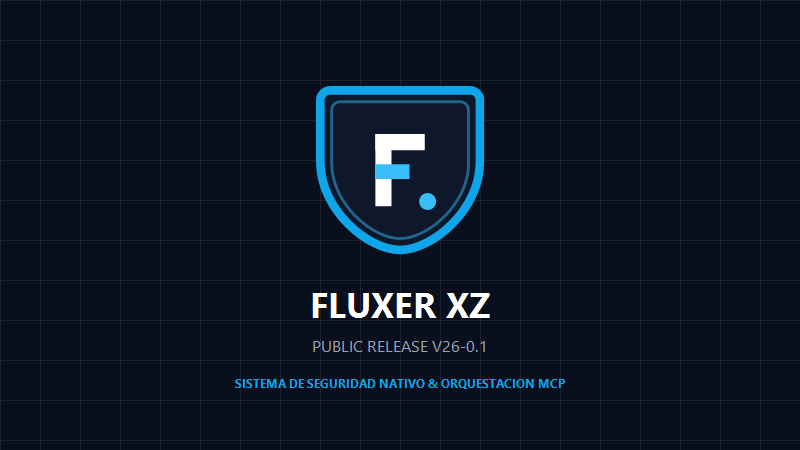

# FLUXER XZ — Public Release V26-0.1

<div align="center">
  
  <br/>
  <strong>Servidor MCP de Alto Rendimiento para Windows con Modo Compacto Real, Seguridad Nativa y Aplicación de Escritorio Oficial</strong>
  <br/>
  <em>Versión Oficial: V26-0.1 · Arquitectura Limpia de 6 Carpetas</em>
</div>

---

## 🌟 Características Principales

- **Aplicación Oficial de Escritorio Nativizada (`FluxerXZ.exe`)**:
  - Interfaz de usuario nativa moderna en C# / WPF con tema oscuro obsidiana (`#0A0F1D`) y aceleración DirectX por hardware.
  - Cero dependencias de Electron, Chromium o frameworks web pesados; ejecutable autónomo ultra-ligero (~88 KB).
  - Animaciones fluidas XAML (transición de pestañas con curva cúbica suave y notificaciones flotantes animadas).
  - Panel interactivo con 6 módulos: Dashboard en vivo, Centro de Seguridad, Catálogo de 11 Herramientas, Actualizador Remoto, Generador de Feedback y Configuración de Clientes MCP (Antigravity, Claude, Cursor).
  - Lanzador dual inteligente (`FLUXER_XZ_LAUNCHER.bat`): Inicia la aplicación nativa por defecto o la consola interactiva con el parámetro `--cli`.
- **Modo Compacto de Próxima Generación (`core/compact.mjs`)**:
  - Ahorro de tokens real y medido del **88% al 99%** sin trucos contraproducentes (cero base64, cero morse, cero binarios).
  - **Content Stashes (`stash#id`)**: La IA envía bloques largos una sola vez y los reutiliza por referencia en múltiples archivos u operaciones.
  - **Handles Cortos (`f#1`, `doc#1`)**: Operaciones sobre archivos y documentos sin repetir rutas extensas en cada mensaje.
  - **Escritura Incremental (`patch_file`)**: Parches quirúrgicos por texto ancla o rango de líneas en vez de reescribir archivos enteros.
  - **Lectura Inteligente y Caché Local**: Detección de "sin cambios" mediante hash SHA-256 local y lecturas por rango de líneas.
- **Seguridad con Identidad Oficial (`core/permissions.mjs`)**:
  - Título propio y fijo `"Fluxer XZ · Seguridad"` y escudo minimalista oficial en diálogos y notificaciones de Windows.
  - Notificaciones nativas integradas con `AppUserModelID` registrado (`FluxerXZ.Security.V26`) y gráficos vectoriales transparentes ARGB de 32 bits (sin bordes oscuros de recorte).
  - 4 niveles de riesgo rigurosos: `LOW`, `MEDIUM`, `HIGH` y `DESTRUCTIVE`.
  - Protección estricta de rutas críticas (`System32`, `SysWOW64`, hives de registro SAM/SYSTEM/SECURITY, claves SSH, credenciales cloud y archivo hosts).
  - Elevación persistente por sesión sin diálogos repetitivos; acciones destructivas siempre exigen confirmación explícita.
- **Motor de Atajos y Macros Multi-Paso (`tools/shortcuts.mjs`)**:
  - Ejecución de pipelines complejos con una sola llamada.
  - Soporte de plantillas con variables `{{param}}`, dry-run y rollback automático ante fallos.
  - 6 atajos de producción preconfigurados de fábrica.
  - Carpeta configurable por el usuario (`data/shortcuts/`).
- **Actualizador Remoto Autónomo (`updater/updater.mjs`)**:
  - Independiente de Git CLI; ejecuta exclusivamente con Node.js y componentes nativos del sistema.
  - Verificación estricta de suma de comprobación SHA-256 antes de extraer.
  - Reemplazo atómico con respaldo automático previo en `data/backups/`.
  - Verificación física de versión en disco tras la actualización y rollback instantáneo ante discrepancias.
- **Puente de Feedback Privado (`tools/feedback.mjs`)**:
  - Almacenamiento local en `data/feedback/` con anonimización automática de rutas personales (`~`).
  - Generador de enlaces directos a GitHub Issues sin exponer credenciales ni webhooks en el paquete.
  - Ejecutable tanto vía MCP como CLI independiente (`node tools/feedback.mjs --submit "Título" "Descripción"`).

---

## 🛠️ Catálogo de las 11 Herramientas

| Herramienta | Archivo | Descripción y Capacidades |
|---|---|---|
| **files** | `tools/files.mjs` | Lectura por rango, parches por ancla, escritura incremental, búsqueda recursiva, copia y borrado seguro a papelera. |
| **terminal** | `tools/terminal.mjs` | Ejecución de comandos powershell/cmd, procesos en segundo plano con control de trabajos y scripts temporales. |
| **system** | `tools/system.mjs` | Diagnóstico de hardware (CPU, RAM, batería), procesos, servicios de Windows, red (ping, DNS, puertos) y paquetes (winget, npm). |
| **web** | `tools/web.mjs` | Búsqueda web DuckDuckGo, extracción limpia de texto de páginas web y descargas seguras con verificación SHA-256. |
| **documents** | `tools/documents.mjs` | Automatización en vivo (COM) y headless de Word, Excel, PowerPoint y PDF (estructuras, textos, tablas, diapositivas). |
| **media** | `tools/media.mjs` | Captura visual no intrusiva de pantalla, ventanas y aplicaciones, y centro de gestión de colas de impresión de Windows. |
| **shortcuts** | `tools/shortcuts.mjs` | Orquestación de macros multi-paso, gestión de plantillas Mustache, validación y ejecución con rollback. |
| **security** | `tools/security.mjs` | Estado de privilegios, solicitud/revocación de elevación, registro forense y validación criptográfica de hashes. |
| **upd** | `tools/upd.mjs` | Interfaz MCP para consulta, descarga, aplicación y reversión de actualizaciones remotas. |
| **feedback** | `tools/feedback.mjs` | Registro de reportes y sugerencias locales, exportación y apertura asistida de issues en GitHub. |
| **guide** | `tools/guide.mjs` | Catálogo dinámico bajo demanda, documentación perezosa de herramientas y estado del servidor. |

---

## 📊 Medición Real del Ahorro de Tokens (Compact Mode)

Mediciones físicas reales ejecutadas sobre la suite de pruebas:

| Escenario | Línea Base Anterior | Fluxer XZ V26-0.1 | Reducción Real | Método Empleado |
|---|---|---|---|---|
| **Catálogo de Herramientas** | 19,999 tokens | 2,373 tokens | **-88.1%** | Consolidación a 11 herramientas y esquemas compactos |
| **Lectura de Código** | 36,827 tokens | 257 tokens | **-99.3%** | Lectura por rango (`startLine`/`endLine`) y handles |
| **Re-lectura Sin Cambios** | 36,827 tokens | 24 tokens | **-99.9%** | Verificación local de hash SHA-256 |
| **Modificación de 500 Líneas** | 13,949 tokens | 66 tokens | **-99.5%** | `patch_file` quirúrgico por texto ancla |
| **Reutilización de Código** | 13,949 tokens | 17 tokens | **-99.9%** | `stash#<id>` por referencia |
| **Edición de Documento Office** | 3,356 tokens | 30 tokens | **-99.1%** | Operaciones estructurales (`insert_paragraph`) y handles |

---

## 🚀 Conexión al Cliente MCP

Agregue Fluxer XZ a su archivo de configuración MCP (`mcp_config.json` en Antigravity, Claude Desktop o Cursor):

```json
{
  "mcpServers": {
    "Fluxer_XZ": {
      "command": "node",
      "args": [
        "C:/Ruta/A/FLUXER XZ/server.mjs"
      ]
    }
  }
}
```

O utilice el punto de entrada retrocompatible `server.js`.

---

## 🔒 Seguridad y Privacidad

Para detalles sobre el modelo de permisos, políticas de elevación y rutas del sistema bloqueadas, consulte [docs/SECURITY.md](docs/SECURITY.md).

---

## 📄 Licencia

Distribuido bajo la Licencia MIT. Consulte [LICENSE](LICENSE) para más información.

