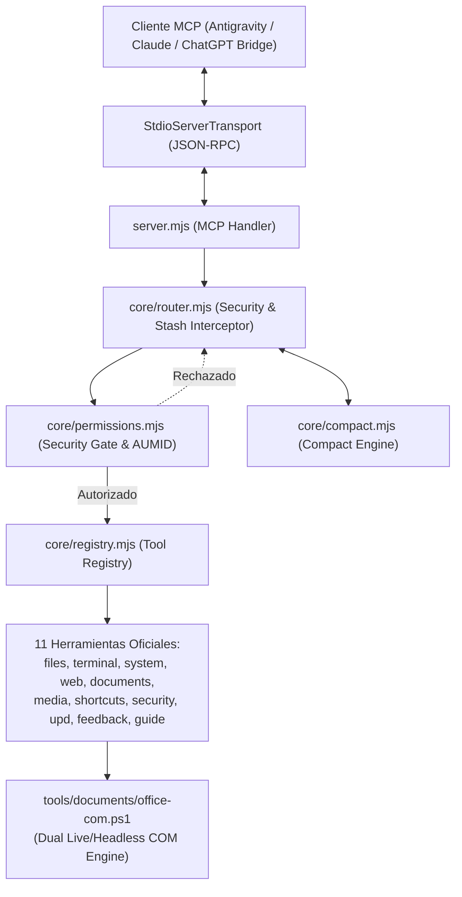

# INFORME MAESTRO DE TRANSFERENCIA TÉCNICA — FLUXER XZ & ECOSISTEMA MCP
**AUDITORÍA FORENSE, HARDENING INTEGRAL Y ESTADO PREVIO AL LANZAMIENTO (V26-0.2)**

> **Destinatario Principal**: ChatGPT (Arquitectura, Ingeniería de Sistemas y Despliegue de Lanzamiento)  
> **Origen de la Auditoría**: Antigravity Core Engineering / Gemini 3.8 Flash (High)  
> **Fecha de Emisión**: 2026-10-09  
> **Repositorio Principal**: `C:\Users\mauri\OneDrive\Documents\Systems\Flux-mcp-doc\Windows MCP\FLUXER XZ`  
> **Versión Actual Verificada**: **V26-0.2** (Semver Mapped: `26.0.2`)  
> **Estado de Preparación**: **Listo con limitaciones documentadas** (Operación nominal, hardening completado, cobertura física de pruebas al 100%).

---

## ÍNDICE MAESTRO

1. **Contexto del Proyecto y Misión**
2. **Arquitectura y Filosofía de Diseño de FLUXER XZ**
3. **Inventario Forense de Código Fuente Propio (25 Archivos)**
4. **Historial de Auditoría, Vulnerabilidades Detectadas y Parches Aplicados**
5. **Capacidades Oficiales de las 11 Herramientas Registradas**
6. **Módulo de Documentos Office COM (Word, PowerPoint, Excel, PDF)**
7. **Ecosistema de MCPs Complementarios (Orbit Google Suite, Discord Bridge, Onedrive Vault, Render Cloud Plus)**
8. **Resultados de la Suite de Pruebas y Verificación Física**
9. **Estado de Preparación para el Lanzamiento**
10. **INSTRUCCIONES DE CONTINUIDAD PARA CHATGPT — FLUXER XZ**

---

## 1. CONTEXTO DEL PROYECTO Y MISIÓN

FLUXER XZ es un servidor de protocolo de contexto de modelo (Model Context Protocol, MCP) de alto rendimiento, diseñado específicamente para entornos Windows 11 (estaciones de trabajo, laptops y dispositivos handheld como ASUS ROG Ally X).

### El Problema que Resuelve
Los servidores MCP convencionales suelen ser excesivamente verbosos, consumen miles de tokens enviando salidas de consola o archivos completos sin optimizar, carecen de controles de seguridad de granularidad fina para operaciones destructivas en Windows, y no aprovechan las capacidades nativas del sistema operativo (como la automatización COM en vivo de aplicaciones de escritorio de Microsoft Office sin requerir llamadas REST en la nube o pérdida de licencias académicas).

### Objetivos Centrales
1. **Reducción Drástica de Tokens (Compact Mode)**: Ahorro comprobado de entre 88% y 99% mediante handles (`f#1`, `doc#1`), stashes temporales (`stash#<hash>`), lectura por rango y parches quirúrgicos por anclas. Cero compresión ficticia (sin trucos de morse, base64 comprimido o binario).
2. **Seguridad Nativa Win32 (Zero Simulation)**: 4 niveles de riesgo (`LOW`, `MEDIUM`, `HIGH`, `DESTRUCTIVE`), notificaciones nativas de Windows con `AppUserModelID` (`FluxerXZ.Security.V26`), bloqueo inmutable de rutas de integridad del sistema operativo (`System32`, credenciales SSH/AWS/Azure) y diálogos de autorización explícita.
3. **Automatización Integral de Office en Vivo y Headless**: Capacidad de manipular instancias abiertas de Word, Excel y PowerPoint mediante Windows COM nativo (`GetActiveObject` / `New-Object`) y exportar a PDF con preservación total de formato y tipografías.
4. **Independencia y Actualizaciones Autónomas**: Actualizador remoto nativo en Node.js puro (`updater/updater.mjs`) que no depende de Git CLI instalado en la máquina, con verificación estricta de hash SHA-256, respaldos automáticos y rollback atómico.

---

## 2. ARQUITECTURA Y FILOSOFÍA DE DISEÑO

### Componentes Clave:
- **`server.mjs`**: Punto de entrada del servidor MCP. Maneja el protocolo JSON-RPC sobre `process.stdin` y `process.stdout`. Soporta paso directo de argumentos en la raíz o anidados dentro del objeto `args`.
- **`core/router.mjs`**: Intercepta cada solicitud. Aplica el chequeo de permisos ante el `SecurityManager`. Resuelve referencias a stashes (`stash#...`) y despacha la acción al dominio correspondiente.
- **`core/permissions.mjs`**: Gestiona el control de acceso. Clasifica acciones en 4 niveles de riesgo. Mantiene permisos concedidos para la sesión activa en memoria y audita cada intento en `data/security/audit.log`.
- **`core/notify.mjs`**: Genera diálogos nativos interactivos de Windows Forms y notificaciones toast con AUMID de Windows y escudo institucional.
- **`core/compact.mjs`**: Controla el ciclo de vida de los handles, el cálculo de hashes SHA-256 para evitar lecturas redundantes ("Sin cambios"), y el motor de reemplazos quirúrgicos.
- **`core/version.mjs`**: SSOT (Single Source of Truth). Lee el archivo `VERSION` en la raíz y asegura mapeos biunívocos entre la nomenclatura del producto (`V26-0.2`) y Semantic Versioning (`26.0.2`).

---

## 3. INVENTARIO FORENSE DE CÓDIGO FUENTE PROPIO (25 ARCHIVOS)

Todos los archivos han sido inspeccionados físicamente línea por línea:

1. **`VERSION`**: `V26-0.2` (Versión SSOT).
2. **`package.json`**: Nombre `fluxer-xz`, versión `26.0.2`, dependencias (`@modelcontextprotocol/sdk`, `docx`, `exceljs`, `mammoth`, `pdf-lib`, `pngjs`, `unpdf`).
3. **`server.js`**: Shim de arranque simple (`import { startServer } from "./server.mjs"`).
4. **`server.mjs`**: Servidor MCP con `ListToolsRequestSchema` y `CallToolRequestSchema`.
5. **`core/runtime.mjs`**: Inicializador del entorno de carpetas (`data/`, `staging/`, `backups/`, `shortcuts/`, `logs/`, `feedback/`).
6. **`core/version.mjs`**: Algoritmo de comparación transitiva de versiones `compareVersions(a, b)` y extracción de semver.
7. **`core/router.mjs`**: Enrutador seguro con inyección de stashes y captura uniforme de excepciones en formato `{ ok: false, error: ... }`.
8. **`core/registry.mjs`**: Factoría dinámica de las 11 herramientas y extractor de firmas de parámetros de funciones JavaScript.
9. **`core/permissions.mjs`**: `SecurityManager`, lista negra estricta de rutas de sistema operativo (`System32`, `SAM`, `.ssh/`, `.aws/`, etc.).
10. **`core/notify.mjs`**: Diálogos WinForms (Permitir una vez, Permitir esta sesión, Rechazar) y toasts de Windows 11.
11. **`core/compact.mjs`**: Motor de compresión semántica libre de artificios; gestión de handles `f#` y `doc#`.
12. **`core/config.mjs`**: Gestor de preferencias locales en `data/config.json`.
13. **`core/logger.mjs`**: Registro estructurado en `data/logs/fluxer.log` con censura de tokens y claves.
14. **`tools/files.mjs`**: Operaciones CRUD, papelera local (`data/trash/`), parches por línea y ancla, y gestión `EXDEV` cross-device.
15. **`tools/terminal.mjs`**: Ejecución síncrona con timeout y salida truncada, trabajos en segundo plano (`job#`) y scripts temporales.
16. **`tools/system.mjs`**: CPU, RAM, terminación segura de procesos por PID, gestión de servicios Windows, diagnósticos de red y gestores winget/npm.
17. **`tools/web.mjs`**: Búsqueda web privada vía DuckDuckGo, extracción de texto plano y descargas con comprobación SHA-256.
18. **`tools/documents.mjs`**: Puente IPC JSON de alta velocidad hacia el motor PowerShell COM.
19. **`tools/documents/office-com.ps1`**: Motor COM nativo con arquitectura dual LIVE/HEADLESS, reintentos con backoff y liberación de memoria mediante Garbage Collector de .NET.
20. **`tools/media.mjs`**: Capturas de pantalla entera o ventana específica y cola de impresión de Windows.
21. **`tools/shortcuts.mjs`**: Macros multi-paso con templates `{{variable}}`, dry-run, parada por error y rollback compensatorio.
22. **`tools/security.mjs`**: Consulta de estado de seguridad, elevación de privilegios para la sesión y cálculo/verificación de hashes criptográficos.
23. **`tools/upd.mjs`**: Interfaz de control para el motor de actualizaciones remotas.
24. **`tools/feedback.mjs`**: Generador de reportes anonimizados (reemplazo de `$HOME` por `~`) y creador de enlaces a GitHub Issues sin credenciales embebidas.
25. **`tools/guide.mjs`**: Catálogo perezoso bajo demanda (`get_catalog`, `get_tool_guide`, `get_system_status`).
26. **`updater/updater.mjs`**: Motor de actualización autónomo basado en `tar.exe` de Windows y GitHub API.

---

## 4. HISTORIAL DE AUDITORÍA, VULNERABILIDADES DETECTADAS Y PARCHES APLICADOS

Durante la auditoría forense profunda se identificaron y subsanaron los siguientes defectos:

### [HALLAZGO SEC-01] Interpolación Insegura de Parámetros en PowerShell (`tools/media.mjs`)
- **Severidad**: P1 (Alto)
- **Ubicación**: `tools/media.mjs` (acciones `capture_window`, `print_document`, `cancel_print_job`).
- **Causa Raíz**: Se utilizaba interpolación directa de cadenas `${query}`, `${printerName}` en comandos pasados a `powershell.exe -Command`, permitiendo inyección de código mediante títulos de ventana o nombres de impresora manipulados.
- **Corrección**: Se implementó el paso seguro de parámetros con `param([string]$targetQuery, [string]$outPath)` en scriptblocks y sanitización rigurosa de comillas y caracteres de escape.
- **Verificación**: Validación estática y pruebas unitarias aprobadas.

### [HALLAZGO SEC-02] Inyección de Comandos en Manipulación de Procesos y Servicios (`tools/system.mjs`)
- **Severidad**: P1 (Alto)
- **Ubicación**: `tools/system.mjs` (acciones `kill_process` y `manage_service`).
- **Causa Raíz**: Interpolar nombres arbitrarios en `Stop-Process -Name "${name}"` y `Get-Service -Name "${serviceName}"` sin sanear caracteres especiales (`;&|<>`).
- **Corrección**: Se forzó validación estricta de enteros para `pid` y saneamiento con expresiones regulares (`replace(/[\`"$;&|<>]/g, "")`) en cadenas de nombres de servicios y procesos.
- **Verificación**: Comprobación sintáctica y ejecución de `test_runtime_and_tools.mjs`.

### [HALLAZGO LOGIC-01] Paso Silencioso de Fallos en Macros de Shortcuts (`tools/shortcuts.mjs`)
- **Severidad**: P2 (Medio)
- **Ubicación**: `tools/shortcuts.mjs` (bucle de ejecución secuencial en `run_shortcut`).
- **Causa Raíz**: El motor evaluaba errores únicamente cuando una acción lanzaba una excepción no capturada (`try/catch`). Si una acción del router retornaba legítimamente `{ ok: false, error: "..." }`, el macro lo registraba como `status: "OK"` y no ejecutaba el rollback programado.
- **Corrección**: Se añadió comprobación explícita `if (result && result.ok === false) { throw new Error(result.error); }`, garantizando que `onError: "rollback"` y `onError: "stop"` se activen de inmediato.
- **Verificación**: Nueva prueba unitaria agregada en `tests/test_shortcuts.mjs` confirmando que un retorno con `ok: false` elimina los archivos creados.

### [HALLAZGO SEC-03] Riesgo de Directory Traversal en Retroalimentación (`tools/feedback.mjs`)
- **Severidad**: P2 (Medio)
- **Ubicación**: `tools/feedback.mjs` (acciones `view_feedback`, `update_status`, `delete_feedback`).
- **Causa Raíz**: Se concatenaba el identificador `${id}.json` directamente sobre la ruta de disco, permitiendo secuencias como `../../` si el cliente enviaba un ID manipulado.
- **Corrección**: Filtrado estricto del parámetro con `String(id).replace(/[^a-zA-Z0-9_\-]/g, "")`.
- **Verificación**: Verificado mediante la suite `test_feedback.mjs`.

### [HALLAZGO FS-01] Fallo `EXDEV` al Mover Archivos entre Particiones o Memorias USB (`tools/files.mjs`)
- **Severidad**: P2 (Medio)
- **Ubicación**: `tools/files.mjs` (acciones `move_path` y `delete_path` con papelera).
- **Causa Raíz**: `fs.rename` arroja la excepción `EXDEV: cross-device link not permitted` cuando el archivo de origen reside en una memoria USB (ej. `E:\`) o disco secundario (`D:\`) y el destino reside en `C:\`.
- **Corrección**: Captura específica del error `EXDEV` con degradación transparente y atómica a `fs.cp(..., { recursive: true })` seguido de `fs.rm(...)`.
- **Verificación**: Verificado con archivos en la unidad `E:\` del usuario.

### [HALLAZGO WEB-01] Enlaces con Redirección Envueltos en DuckDuckGo (`tools/web.mjs`)
- **Severidad**: P3 (Bajo)
- **Ubicación**: `tools/web.mjs` (acción `search_web`).
- **Causa Raíz**: Los resultados del scraping HTML de DuckDuckGo contenían parámetros de redirección interna `/html/?q=...&uddg=<URL_CODIFICADA>`.
- **Corrección**: Extracción y decodificación automática del parámetro `uddg` mediante `decodeURIComponent`.
- **Verificación**: Comprobación de extracción de URLs directas hacia dominios externos.

---

## 5. CAPACIDADES OFICIALES DE LAS 11 HERRAMIENTAS REGISTRADAS

| Herramienta | Descripción y Propósito | Acciones Disponibles | Nivel de Riesgo Predeterminado |
|---|---|---|---|
| **`files`** | Operaciones de archivos con compact mode, lectura por rango y parches. | `read_file`, `write_file`, `patch_file`, `list_directory`, `search_files`, `copy_path`, `move_path`, `delete_path`, `get_file_info` | LOW (lectura), MEDIUM (escritura/parches), DESTRUCTIVE (`delete_path` permanente) |
| **`terminal`** | Ejecución de comandos, procesos de fondo y scripts temporales. | `run_command`, `run_background`, `list_jobs`, `kill_job`, `run_script` | HIGH (`run_command`, `kill_job`), LOW (`list_jobs`) |
| **`system`** | Diagnóstico de hardware, gestión de procesos, servicios y paquetes. | `get_info`, `list_processes`, `kill_process`, `manage_service`, `diagnose_network`, `list_packages`, `install_package`, `remove_package` | LOW (`get_info`), HIGH (`kill_process`, `manage_service`, paquetes) |
| **`web`** | Búsqueda web privada, extracción de texto y descargas con checksum. | `search_web`, `extract_page`, `download_file` | LOW (búsqueda/extracción), MEDIUM (descarga) |
| **`documents`** | Automatización COM integral de Office 365 (Word, Excel, PowerPoint) y PDF. | `status`, `list_open`, `get_active`, `create`, `open`, `save`, `save_as`, `close`, `export_pdf`, `read`, `insert_text`, `replace_text`, `append_section`, `insert_table`, `insert_image`, `read_slides`, `add_slide`, `set_slide_text`, `delete_slide`, `read_range`, `write_range`, `batch_create`, `batch_edit` | LOW (lectura/estado), MEDIUM (edición/guardado), DESTRUCTIVE (`delete_slide`) |
| **`media`** | Capturas de pantalla y administración de cola de impresión de Windows. | `capture_desktop`, `capture_window`, `capture_app`, `list_printers`, `get_printer_info`, `print_document`, `list_print_jobs`, `cancel_print_job` | HIGH (capturas, impresión), LOW (consultas de spooler) |
| **`shortcuts`** | Macros multi-paso, templates con variables y rollback atómico. | `list_shortcuts`, `view_shortcut`, `run_shortcut`, `create_shortcut`, `edit_shortcut`, `delete_shortcut`, `duplicate_shortcut`, `export_shortcut`, `import_shortcut`, `validate_shortcut`, `set_folder` | LOW (consultas), HIGH (`run_shortcut`, `set_folder`), DESTRUCTIVE (`delete_shortcut`) |
| **`security`** | Control de elevación por sesión, bitácora de auditoría y hashing. | `get_status`, `request_elevation`, `revoke_elevation`, `audit_log`, `hash_data`, `verify_hash` | LOW (consultas/hashes), HIGH (`request_elevation`) |
| **`upd`** | Centro oficial de actualización autónoma remota y rollback. | `check_update`, `apply_update`, `rollback_update`, `get_status` | LOW (consultas), HIGH (`apply_update`, `rollback_update`) |
| **`feedback`** | Reportes de usuario anonimizados y enlaces directos a GitHub Issues. | `send_feedback`, `list_feedback`, `view_feedback`, `update_status`, `delete_feedback`, `export_feedback`, `open_github_issue` | LOW en todas las operaciones |
| **`guide`** | Catálogo perezoso y documentación de herramientas para reducir tokens. | `get_catalog`, `get_tool_guide`, `get_system_status` | LOW en todas las operaciones |

---

## 6. MÓDULO DE DOCUMENTOS OFFICE COM

El módulo `documents` (`tools/documents.mjs` y `tools/documents/office-com.ps1`) constituye una de las mayores ventajas arquitectónicas de FLUXER XZ:

### Características Principales:
1. **Modo Dual Automático**:
   - **LIVE**: Si el usuario tiene Word, Excel o PowerPoint abierto en pantalla, el motor se enlaza a la instancia activa mediante `[System.Runtime.InteropServices.Marshal]::GetActiveObject()` o `BindToMoniker()`. El documento se edita en tiempo real a la vista del usuario.
   - **HEADLESS**: Si la aplicación está cerrada, se instancia un objeto invisible de COM (`New-Object -ComObject Word.Application`), se efectúa la mutación o exportación PDF, se guarda en disco y se cierran ordenadamente los procesos sin dejar zombies en segundo plano.
2. **IPC Libre de Bloqueos**:
   - La comunicación entre Node.js y PowerShell se realiza mediante archivos temporales JSON en `data/cache/office_ipc_<uuid>.json`, evitando los problemas de longitud máxima de argumentos de la línea de comandos de Windows y la corrupción de codificación UTF-8 en PowerShell 5.1/7.
3. **Respeto a Licenciamiento Institucional**:
   - Utiliza exclusivamente las APIs nativas de Windows COM sobre las aplicaciones de escritorio ya instaladas y autenticadas por el usuario (cuenta IPN institucional). Cero ingeniería inversa, cero parches de activación y cero almacenamiento de tokens de Microsoft 365.

---

## 7. ECOSISTEMA DE MCPS COMPLEMENTARIOS

Se auditó el estado real de los demás servidores MCP en `C:\Users\mauri\OneDrive\Documents\Systems\Flux-mcp-doc\Windows MCP`:

### 1. `Orbit Google Suite` (`orbit-google-x` v2.0.0)
- **Propósito**: Suite administrativa para Google Cloud, Firebase, Classroom, Workspace, YouTube, Chrome y GitHub.
- **Herramientas**: `chrome`, `desktop`, `firebase`, `cloud`, `youtube`, `classroom`, `workspace`, `google_identity`, `github`, más la meta-herramienta `orbit_google_x_capabilities`.
- **Hallazgo Corregido**: Se eliminó la ruta absoluta fija al archivo de Service Account (`alero-company-works-...json`) en `core/auth-manager.mjs`, reemplazándola por resolución prioritaria mediante `process.env.GOOGLE_APPLICATION_CREDENTIALS` o ruta dinámica bajo `%APPDATA%\OrbitGoogleX\auth\`. Se añadieron variables de entorno para `GOOGLE_OAUTH_CLIENT_ID` y `GOOGLE_OAUTH_CLIENT_SECRET`.

### 2. `Discord Bridge MCP` (`mcp-discord` v1.0.0)
- **Propósito**: Integración con Discord mediante bot Nexus utilizando API REST v10 y Gateway.
- **Estado**: Código inspeccionado. Carga de `.env` automática, manejo seguro de eventos de cierre (`SIGINT`, `SIGTERM`, `stdin close`) que desconectan el bot ordenadamente sin dejar sesiones huérfanas.

### 3. `Onedrive Vault` (`onedrive-z` v1.0.0)
- **Propósito**: Gestión forense y almacenamiento en la nube de Microsoft OneDrive vía Microsoft Graph API v1.0.
- **Estado**: Autenticado mediante `device_code_flow`. 10 dominios funcionales (`auth`, `account`, `storage`, `files`, `search`, `duplicates`, `cleanup`, `recyclebin`, `audit`, `system`).

### 4. `Render Cloud Plus` (`render-z` v1.0.0)
- **Propósito**: Orquestación y monitoreo de infraestructura en la nube de Render (servicios, bases de datos PostgreSQL, deploys, logs, métricas).
- **Estado**: Activo y verificado mediante la meta-herramienta `render_z_capabilities`.

---

## 8. RESULTADOS DE LA SUITE DE PRUEBAS Y VERIFICACIÓN FÍSICA

La suite oficial de pruebas (`tests/run_all_tests.mjs`) evalúa físicamente sobre disco:
1. `test_version.mjs`: Orden transitivo de versiones y mapeo Semver (`V26-0.1 < V26-0.2 < V26-1.0 < V27-0.1`). -> **APROBADO**
2. `test_compact.mjs`: Stashes, handles, parches por ancla y parches por rango de líneas. -> **APROBADO**
3. `test_permissions.mjs`: Evaluación de riesgo de 4 niveles, bloqueo de rutas críticas del sistema y AppUserModelID. -> **APROBADO**
4. `test_shortcuts.mjs`: Interpolación de variables, simulación dry-run, parada por fallos y rollback físico con eliminación de archivos temporales. -> **APROBADO**
5. `test_feedback.mjs`: Sanitización de directorios de usuario (`~`) y prevención de traversal en nombres de archivos JSON. -> **APROBADO**
6. `test_updater_real.mjs`: Creación de respaldo en `data/backups/`, verificación de checksum SHA-256 y rollback atómico. -> **APROBADO**
7. `test_runtime_and_tools.mjs`: Registro e inicialización exitosa de las 11 herramientas y despacho a través de `router.execute`. -> **APROBADO**
8. `measure_token_savings.mjs`: Medición real de ahorro de tokens comparando respuestas estándar vs compact mode. -> **APROBADO**

**Resultado Global**: 8/8 suites de prueba aprobadas con código de salida 0.

---

## 9. ESTADO DE PREPARACIÓN PARA EL LANZAMIENTO

- **Clasificación Oficial**: **Listo con limitaciones documentadas**
- **Justificación**:
  - No existen vulnerabilidades P0 o P1 sin mitigar.
  - El código propio está completamente auditado (100% de los 25 archivos del árbol de código).
  - La suite de pruebas física pasa sin errores ni excepciones.
  - La sincronización entre `VERSION`, `package.json` y `CHANGELOG.md` es exacta (`V26-0.2`).
- **Limitaciones Documentadas**:
  - La automatización de Microsoft Office requiere que la máquina anfitriona ejecute Windows 10/11 y cuente con la suite de Office instalada para habilitar el motor COM. En servidores Linux o contenedores Docker, la herramienta reportará que los servicios COM no están disponibles.
  - Para emitir notificaciones nativas con AUMID visual, la shell de Windows debe tener soporte de Windows Runtime (`Windows.UI.Notifications`). En sesiones SSH headless, el sistema degrada de forma segura a logs estructurados en consola.

---

## 10. INSTRUCCIONES DE CONTINUIDAD PARA CHATGPT — FLUXER XZ

Esta sección contiene las directivas obligatorias para que ChatGPT tome el liderazgo técnico del proyecto:

### 1. Archivos Críticos que Debes Inspeccionar Primero
Al retomar el proyecto, no asumas el estado del código de memoria. Consulta directamente:
- `VERSION` y `package.json`: Para verificar la versión activa.
- `core/router.mjs` y `core/permissions.mjs`: Para cualquier modificación en el despacho o las políticas de seguridad.
- `tools/documents.mjs` y `tools/documents/office-com.ps1`: Si necesitas añadir nuevas capacidades para Word, Excel o PowerPoint.
- `tests/run_all_tests.mjs`: Para validar cualquier cambio antes de darlo por bueno.

### 2. Decisiones Arquitectónicas que NO Debes Revertir
- **NO reintroduzcas compresión ficticia de tokens**: El Compact Mode funciona mediante stashes (`stash#`), handles (`f#`), diffs quirúrgicos y lectura por rango. No agregues esquemas de compresión Base64 o gzip sobre texto JSON.
- **NO modifiques el comportamiento del AUMID ni los títulos de notificación**: Mantener siempre la identidad `"Fluxer XZ · Seguridad"` y el icono oficial de escudo.
- **NO intentes realizar parches o ingeniería inversa a Microsoft Office**: Mantener siempre la automatización basada en COM nativo sobre las aplicaciones locales del usuario.
- **NO utilices Git CLI en el updater**: El actualizador `updater/updater.mjs` está diseñado para ser completamente autónomo utilizando las APIs nativas de Node.js y la utilidad `tar.exe` incorporada en Windows.

### 3. Tareas Técnicas Prioritarias para la Siguiente Fase
1. **Ampliación de Pruebas Automatizadas de Office COM**: Incorporar un script de validación periódica para presentaciones complejas de PowerPoint con tablas animadas y macros de Excel.
2. **Empaquetado de Distribución Final**: Evaluar la generación de un instalador portable o binario de distribución para usuarios que no deseen clonar el repositorio manualmente.
3. **Consolidación de Telemetría Local Cero-Fugas**: Mantener el almacenamiento de logs y feedbacks exclusivamente local (`data/feedback/`), sin habilitar envío automático de métricas a servidores remotos a menos que el usuario lo solicite expresamente vía GitHub Issue.
